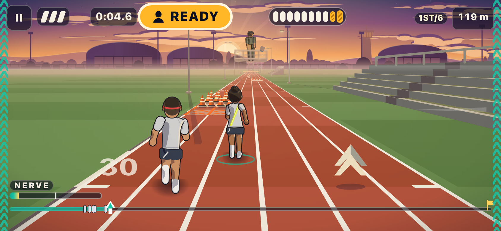

# Flightline Sprint: Freeze Drill

Run on the chant. Freeze when they turn. Drop when you don't.

A behind-the-runner sprint down a training track toward a watchtower. While the Proctor faces away and the Korean
children's chant plays, you run. When the chant ends the Proctor turns around. Anyone still moving gets the spotlight,
a whistle and "DROP! GIVE ME FIVE!", then push-ups. The faster you run, the longer you slide, so the skill is
stopping late, fast and clean.

The art is all drawn in code and the music is composed in code. The whole game is one self-contained, offline HTML
file with no installs and no network requests.

Play it at https://vibezzzcoder.github.io/flightline-sprint

You can also download `index.html` from this repository and open it in a browser. It works offline, with no install
and no network connection.

## Screenshot

## How to play

- **Hold to run, let go to brake.** Your momentum carries you, so let go before the chant ends. The last syllables
  and the 10-pip chant bar tell you when it will end, and the chant's pitch tells you its speed.
- **Freeze while you are watched.** The light state always shows four ways: the Proctor's pose, the screen frame
  (scrolling chevrons for go, a static hatch for freeze, a gold frame for the final sprint), the pip bar, and the
  State Badge word (RUN, READY, FREEZE, JOG, HIDDEN, GO GO GO). You do not need colour or sound to read it.
- **Caught?** You hold a plank until the Proctor turns back, then do five push-ups (tapping in time is optional).
  You lose a strike and take a 3-second PAPERWORK penalty. The first catch by each new trick is a warning, and
  S01 catches are practice. Run out of strikes and you are dismissed. Retry is one tap.
- **Use cover.** Crates, tugs, canopies and other runners can block the Proctor's view. While HIDDEN you can creep
  forward.
- **Style.** Stopping just in time at high speed earns CLUTCH and RAZOR. These fill NERVE, and NERVE pays for an
  OVERDRIVE speed burst.

### Controls

| Action | Keyboard | Mouse | Touch |
|---|---|---|---|
| Run (hold) / brake (release) | W, Up or Space | hold the left button | hold a thumb in the bottom Run Zone |
| Change lane | A / D or Left / Right | drag sideways while holding | slide the finger sideways (or swipe with a second finger) |
| Jump | Shift, J or K | flick up | flick up |
| Overdrive (NERVE 50 or more) | E | OVERDRIVE button | OVERDRIVE button |
| Push-up rep | any run key | click | tap |
| Pause / mute | Esc or P / M | pause button | pause button |

It plays on desktop and on phones in portrait and landscape. Sound starts on the first tap. Settings has
tap-to-toggle run, a left-handed layout, the lane-slide threshold, music, SFX and chant volume, reduced motion,
high contrast, captions, quality and an audio-offset calibration.

## Modes

- **Campaign:** 12 stages across dawn track, midday apron, storm and night. Each stage brings in one watcher trick:
  tempo changes, long stares, stutters, short chants, peeks, double-takes, searchlight sweeps and headcounts. Every
  trick is signalled in advance. The campaign ends in a three-act finale, *Final Formation*, followed by an ending
  and credits. Each stage has three stars: finish, beat the gold time, and the stage's special challenge.
- **Long Haul:** an endless run. Difficulty rises in tiers, the environment rotates and new rivals join. It unlocks
  after S03.
- **Daily Drill:** the same seeded 320 m drill for everyone each day, with one modifier of the day. Your first finish
  of the day is Official, and you can copy the result as text. It unlocks after S06.
- **Locker:** play as an airman or an airwoman, with a choice of skin tones and hairstyles. Belts, headbands, shoes
  and freeze poses are earned by playing.
- **Difficulty:** Relaxed, Standard or Hard, with separate records for each. The game also has 16 achievements and
  a stats page.

## Records And Privacy

Progress, records and settings are kept only in this browser's local storage, and Settings has an export / import
code. If storage is blocked, the game keeps progress for the current session only. There are no accounts, analytics,
network leaderboards or online services.

## License

This project is licensed under the GNU General Public License v3.0 or later.

Copyright (C) 2026 VibezZzCoder

This program is free software: you can redistribute it and/or modify it under the terms of the GNU General Public License as published by the Free Software Foundation, either version 3 of the License, or (at your option) any later version.

This program is distributed in the hope that it will be useful, but WITHOUT ANY WARRANTY; without even the implied warranty of MERCHANTABILITY or FITNESS FOR A PARTICULAR PURPOSE. See the GNU General Public License for more details.

See `LICENSE` for the full license text.

## Unofficial Project Disclaimer

This is an independent project. It is not an official U.S. Air Force product. It is not endorsed by, sponsored by, or affiliated with the U.S. Air Force, the Department of the Air Force, or the U.S. Department of Defense.

The project uses fictionalized, stylized, military-inspired characters and settings. No official endorsement is implied.

## Trademarks And Official Marks

The GPL applies to this project's original code and original assets. It does not grant rights to use third-party trademarks, logos, seals, emblems, official marks, official insignia, or protected identifiers.

Do not imply ownership of or affiliation with the U.S. Air Force, Department of the Air Force, or Department of Defense.

## Korean Voiceover Credits

Green light red light by Sandermotions -- https://freesound.org/s/592876/ -- License: Creative Commons 0
